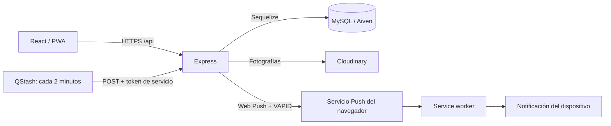

# Fokus · Beta 0.1

**Tu organización académica, en un solo lugar.**

Fokus es una aplicación web/PWA para estudiantes que quieren organizar materias, tareas, exámenes y actividades de estudio sin repartir su información entre varias herramientas. Combina una agenda académica con recordatorios configurables para ayudar a anticipar entregas y prepararse para los próximos exámenes.

[Usar Fokus](https://fokus-app.onrender.com) · [Contrato de API](doc/API-CONTRACT.md) · [Guía de contribución](doc/GIT-WORKFLOW.md)

## Funcionalidades

### Cuenta y perfil

- Registro e inicio de sesión con autenticación JWT.
- Creación y edición del perfil, con fotografía almacenada en Cloudinary cuando está configurado.
- Después del registro, creación del perfil; al guardarlo por primera vez, acceso al Dashboard.
- Acceso a los recursos propios del estudiante mediante validaciones de autenticación y pertenencia.

### Organización académica

- **Materias y profesores:** gestión de materias y de los profesores asociados.
- **Tareas y entregas:** creación, edición, seguimiento de estado y notas. Admiten fecha de entrega o la opción «Sin fecha de entrega».
- **Exámenes:** organización por materia, con fecha obligatoria y hora opcional.
- **Actividades de estudio:** planificación de sesiones por materia y seguimiento de su finalización.
- **Dashboard:** resumen de la actividad académica y de los próximos eventos.
- Formularios de creación de materias, exámenes, tareas y profesores en modales accesibles, con navegación por teclado.

### Notificaciones

- Listado de próximos exámenes y entregas, independiente de la activación de Web Push.
- Activación voluntaria de Push y gestión de suscripciones por dispositivo.
- Hasta **5 recordatorios por tipo de evento**, con anticipación de hasta **30 días**, expresada en días, horas o minutos.
- Preferencias independientes para exámenes y entregas: horarios predeterminados, personalidad y reglas de recordatorio.
- Zona horaria configurable, inicialmente `America/Argentina/Cordoba`, y horario predeterminado inicial de **09:00**. La hora explícita del evento tiene prioridad.
- Horarios de silencio: aplazamiento del aviso hasta su finalización, siempre que el evento siga siendo relevante.
- Personalidades formal, amigable, motivador, sarcástico y sin filtro; esta última requiere consentimiento explícito. También se pueden guardar hasta **10 frases propias por estudiante**.
- Vista previa y prueba local de notificación desde la configuración.
- Motor automático con registro persistente de recordatorios y entregas, controles de concurrencia, deduplicación y reintentos controlados.
- Las tareas completadas, los eventos vencidos y las tareas sin fecha no generan recordatorios de vencimiento.

### Experiencia web/PWA

- Interfaz responsive y temas claro/oscuro con preferencia persistida en `localStorage`.
- Manifest, íconos y service worker para instalación como PWA en navegadores compatibles.
- Recepción Push con la pestaña cerrada, sujeta a permisos y disponibilidad del navegador y del sistema operativo.

El almacenamiento en caché del service worker no equivale a disponer de todas las operaciones académicas sin conexión. Fokus se distribuye como web/PWA; no requiere Capacitor ni una APK.

## Tecnologías

| Área | Herramientas utilizadas |
| --- | --- |
| Frontend | React 19, React Router 7, Vite 8, Bootstrap 5 y Sass |
| Backend | Node.js, Express 5 y módulos ES |
| Base de datos y ORM | MySQL, `mysql2`, Sequelize 6 y migraciones versionadas propias |
| Autenticación y seguridad | JWT, bcryptjs, express-validator, CORS y express-rate-limit |
| Imágenes | Cloudinary, Multer y Sharp |
| Notificaciones | Web Push, VAPID, service worker y `@js-temporal/polyfill` para cálculos temporales |
| Infraestructura | Render para frontend/backend, Aiven para MySQL y QStash para invocaciones programadas |
| Pruebas y desarrollo | Vitest, Supertest, Testing Library, jsdom, Oxlint y Nodemon |

## Arquitectura

El frontend consume una API REST bajo `/api`. Express valida la autenticación y los datos; los controladores y servicios trabajan con los modelos Sequelize y la base MySQL. Cloudinary almacena las fotografías de perfil.



QStash invoca `POST /api/internal/notifications/process` mediante autenticación de servicio, separada del JWT de los estudiantes. El procesador calcula y persiste los recordatorios, procesa lotes acotados y registra los resultados por dispositivo. También existe un ejecutor CLI; no se utilizan temporizadores permanentes dentro de Express.

La configuración de programación contempla un intervalo de dos minutos, timeout de 120 segundos y reintentos HTTP de QStash desactivados. Los reintentos de entrega los controla el motor. La aceptación del proveedor Push no confirma por sí sola que el usuario haya visto el aviso; tampoco se garantiza puntualidad exacta frente a suspensiones o demoras de infraestructura.

## Estructura del repositorio

```text
Fokus/
├── backend/
│   ├── app.js               # Punto de entrada
│   ├── scripts/             # Migraciones y procesamiento CLI
│   ├── src/
│   │   ├── config/          # Entorno, conexión e inicio seguro
│   │   ├── controllers/     # Manejo de solicitudes
│   │   ├── middlewares/     # Autenticación y controles HTTP
│   │   ├── migrations/      # Runner e historial de migraciones
│   │   ├── models/          # Modelos y relaciones Sequelize
│   │   ├── routes/          # API REST y endpoint interno
│   │   ├── services/        # Servicios de imágenes y notificaciones
│   │   └── validators/      # Validación de entradas
│   └── tests/               # Pruebas backend
├── frontend/
│   ├── public/              # Manifest, service worker e íconos
│   └── src/                 # Páginas, componentes, estado, servicios y estilos
├── doc/                     # Contratos y documentación técnica
└── AGENTS.md                # Reglas de trabajo sobre el proyecto
```

## Instalación y ejecución local

### 1. Requisitos

- Git y npm.
- **Node.js 22.12 o posterior de la rama 22, o Node.js 24**, compatibles con las versiones actuales de Vite y Vitest.
- Un servidor MySQL y una **base exclusiva de desarrollo**. Producción utiliza MySQL 8.4 en Aiven; la configuración local también se ha utilizado con MariaDB de XAMPP.

No apuntes el entorno de desarrollo a una base de producción. Las pruebas automatizadas no sustituyen la validación de migraciones en el motor de base de datos elegido.

### 2. Obtener el proyecto e instalar dependencias

```powershell
git clone https://github.com/giiovannie/Fokus.git
cd Fokus
git switch develop
npm ci --prefix backend
npm ci --prefix frontend
```

Los comandos de desarrollo se ejecutan en `backend/` y `frontend/`; el script de pruebas del `package.json` raíz no ejecuta las suites del proyecto.

### 3. Configurar el entorno

Creá manualmente los archivos locales a partir de sus ejemplos:

```powershell
Copy-Item backend/.env.example backend/.env
Copy-Item frontend/.env.example frontend/.env
```

Si ya existen, conservá su configuración. Ambos archivos son privados y deben permanecer fuera de Git. Usá credenciales exclusivas de desarrollo y un `JWT_SECRET` aleatorio; no copies secretos de producción.

**Backend:** completá las variables de `backend/.env.example` según esta referencia:

| Variables | Configuración local |
| --- | --- |
| `NODE_ENV`, `PORT` | `development`, `3000` |
| `DB_HOST`, `DB_PORT` | `127.0.0.1`, `3306` si tu servidor utiliza esos valores |
| `DB_NAME`, `DB_USER`, `DB_PASSWORD` | Base exclusiva y credenciales locales; `DB_NAME` y `DB_USER` son obligatorios |
| `DB_SSL`, `DB_SSL_CA_PATH` | `false` y ruta vacía para una conexión local sin TLS; con TLS, usar CA válida y verificación de certificado |
| `JWT_SECRET` | Obligatorio; generar un secreto exclusivo y no compartirlo |
| `JWT_EXPIRES_IN` | Duración opcional del token, por ejemplo `7d` |
| `FRONTEND_URL` | `http://localhost:5173`, sin `/api` |
| `CORS_ADDITIONAL_ORIGINS` | Opcional; orígenes adicionales explícitos, separados por comas |
| `TRUST_PROXY_HOPS` | `0` para ejecución directa local |
| `CLOUDINARY_REQUIRED` | `false` permite iniciar sin almacenamiento de fotografías configurado |
| `CLOUDINARY_CLOUD_NAME`, `CLOUDINARY_API_KEY`, `CLOUDINARY_API_SECRET` | Opcionales para desarrollo básico; configurar los tres para habilitar fotografías |
| `NOTIFICATION_WORKER_ENABLED` | `false` para empezar sin procesamiento automático |
| `NOTIFICATION_SERVICE_TOKEN` | Solo para el endpoint interno del motor; secreto independiente de al menos 32 caracteres |
| `VAPID_PUBLIC_KEY`, `VAPID_PRIVATE_KEY`, `VAPID_SUBJECT` | Opcionales para iniciar sin Push; configurar los tres para probar envíos reales, con contacto `mailto:` o HTTPS válido |

**Frontend:** configurá esta URL en `frontend/.env`:

```dotenv
VITE_API_URL=http://localhost:3000/api
```

La URL **incluye `/api`**. Las variables `VITE_*` se incorporan al frontend durante el build: nunca deben contener claves privadas, contraseñas ni el token de servicio.

### 4. Preparar el esquema local

El repositorio contiene **19 migraciones**, registradas con nombre y checksum en `FokusMigrations`. Primero verificá que la conexión apunte exclusivamente a tu base local:

```powershell
cd backend
npm run db:migrate:status
```

Para una base local preparada para desarrollo, ejecutá las pendientes con una cuenta de migraciones autorizada **únicamente para esa base**. Si la cuenta habitual de la aplicación tiene permisos limitados, proporcioná las credenciales de migración solo al proceso correspondiente; no amplíes sus permisos permanentes.

```powershell
npm run db:migrate -- --confirm
npm run db:migrate:verify
```

El runner exige confirmación explícita. Al arrancar, el backend autentica la conexión y verifica el esquema: **no ejecuta `sequelize.sync()` ni aplica migraciones automáticamente**. Si hay migraciones pendientes o inconsistencias, detiene el inicio. No existe un comando de rollback automático para usar indiscriminadamente; revisá cualquier fallo antes de repetir una ejecución.

### 5. Iniciar backend y frontend

En una terminal, desde `backend/`:

```powershell
npm run dev
```

En otra, desde `frontend/`:

```powershell
npm run dev
```

Abrí `http://localhost:5173`. Podés comprobar Express en `http://localhost:3000/api/health`; una respuesta correcta contiene `{"status":"ok"}`. Registrá una cuenta local, completá el perfil y creá tus materias para comenzar.

### 6. Probar notificaciones

Desde **Notificaciones → Preferencias** (`/notifications/preferences`), configurá reglas y personalidades. La sección **Probar notificación** muestra una vista previa y permite solicitar permiso para una notificación local: esta prueba no ejecuta recordatorios ni demuestra un envío remoto.

Para Web Push real necesitás las tres variables VAPID, permiso del navegador y una suscripción activa. La clave privada permanece exclusivamente en el backend; el frontend obtiene la pública mediante la API. Usá `localhost` en desarrollo o HTTPS en otros entornos.

El motor automático requiere además su habilitación explícita y una invocación del CLI o del endpoint protegido. Dejá `NOTIFICATION_WORKER_ENABLED=false` mientras preparás el entorno. `npm run start:contingency` inicia el backend con el motor desactivado; no reemplaza la verificación de migraciones. Consultá el [procedimiento del motor](doc/WEB-PUSH-REMINDERS.md) antes de ejecutar un lote que pueda enviar avisos reales.

## Pruebas y build

Desde la raíz:

```powershell
npm test --prefix backend
npm test --prefix frontend
npm run lint --prefix frontend
npm run build --prefix frontend
```

Las suites cubren API, validaciones, autenticación, aislamiento de recursos, migraciones, cálculo temporal y procesamiento de notificaciones, además de componentes y flujos del frontend. El build genera `frontend/dist/`. Para revisarlo localmente, ejecutá `npm run preview` desde `frontend/`.

## Despliegue y documentación

La instalación publicada utiliza Render para la aplicación web y la API, Aiven para MySQL, Cloudinary para fotografías y QStash para el procesamiento periódico. El despliegue requiere migraciones verificadas, variables privadas configuradas en el backend, orígenes CORS explícitos y `VITE_API_URL` apuntando a la API pública al compilar el frontend.

- [Contrato de API](doc/API-CONTRACT.md)
- [Convenciones de ramas y commits](doc/GIT-WORKFLOW.md)
- [Despliegue y migraciones](doc/DATABASE-DEPLOY.md)
- [Backend en Render](doc/RENDER-BACKEND.md)
- [Preferencias y reglas](doc/WEB-PUSH-PREFERENCES.md)
- [Personalidades y frases propias](doc/NOTIFICATION-PERSONALIZATION.md)
- [Transporte Web Push](doc/WEB-PUSH-TRANSPORT.md)
- [Motor de recordatorios](doc/WEB-PUSH-REMINDERS.md)
- [Programación externa](doc/WEB-PUSH-SCHEDULING.md)

Para colaborar, creá una rama de funcionalidad desde `develop`, respetá el contrato de API y ejecutá las verificaciones antes de proponer la integración. No incluyas archivos `.env`, certificados privados, tokens ni credenciales en cambios o documentación.
